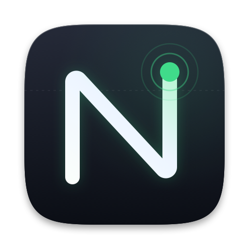
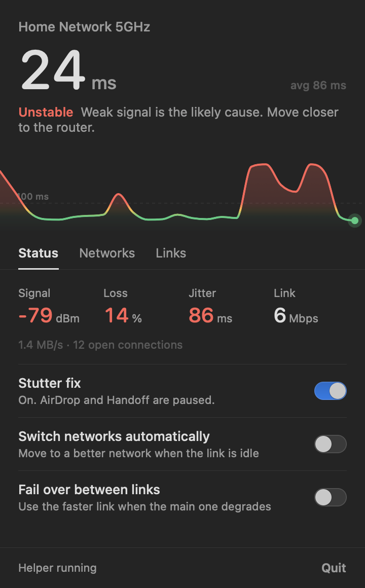
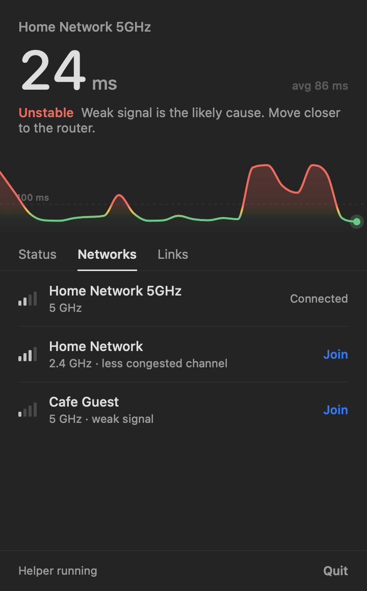

<p align="center">
  
</p>

<h1 align="center">NetPilot</h1>

**A macOS menu bar app that shows how healthy your connection really is, explains why when it isn't, and fixes the most common cause of Wi-Fi stutter.**

NetPilot watches latency, packet loss, jitter and signal strength live, tells you in plain English what is wrong ("Weak signal is the likely cause. Move closer to the router."), ranks your saved Wi-Fi networks, and can switch to a better one or fail over between links without you touching System Settings.

<p align="center">
  
  &nbsp;&nbsp;
  
</p>

<sub>Screenshots use sample data.</sub>

## Why

Public and shared Wi-Fi (hotels, cafés, co-working spaces) fails in ways macOS does not surface: a network that is "connected" but dropping packets, a stronger network sitting unused one room over, or periodic latency spikes that make calls and games stutter.

The last one has a known cause. **AWDL** is the radio protocol behind AirDrop, Handoff and Sidecar. It pulls the Wi-Fi card off-channel roughly twice a second, which shows up as regular latency spikes. NetPilot can keep AWDL down and re-lower it whenever macOS brings it back.

## Features

- **Live latency graph.** Full-width, colour-coded green / amber / red by value, with a 100 ms reference line. Hover to scrub back in time.
- **Plain-English diagnosis.** Combines latency, loss, jitter and signal to name the likely problem instead of just showing numbers.
- **Stutter fix (AWDL control).** One toggle. A small root helper keeps `awdl0` down and re-lowers it after reconnects and sleep/wake.
- **Network ranking.** Scores your saved Wi-Fi networks on signal, band, channel congestion and gateway latency, with the reason for each.
- **One-click join.** Joins a saved network directly. If macOS needs the password, the helper reads it from the System keychain.
- **Per-link measurement.** Probes every active interface (Wi-Fi, iPhone USB tethering, Ethernet) independently, and can run a real download test on each.
- **Automatic failover.** Optionally reorders network services to the healthier link after two consecutive bad readings.
- **Idle-aware auto-switching.** Optionally moves to a better Wi-Fi network, but only when nothing is using the connection (see [Auto-switch behaviour](#auto-switch-behaviour)).
- **Menu bar status.** A pulse icon that turns into a warning triangle when the connection degrades.

## How it works

```
NetPilot.app  (SwiftUI MenuBarExtra, runs as your user, no root)
├── latency   curl --interface <ip> → connectivitycheck.gstatic.com/generate_204
│             TCP connect time per active interface, every 4 s
├── radio     system_profiler SPAirPortDataType → RSSI, link rate (every 6 s)
├── traffic   netstat -ib + lsof → throughput and open connections (every 3 s)
├── ranking   roamr watch --json → scored saved networks (optional dependency)
└── requests  writes /usr/local/etc/netpilot/{awdl_off, request.txt}
                          │
                          ▼
netpilotd     (root LaunchDaemon, ~120 lines of bash)
├── every 2 s  keeps awdl0 / llw0 down while the awdl_off flag exists
└── on request  join an SSID using the stored keychain password,
                or reorder network services
```

Key design decisions:

- **The UI never runs as root.** Only the helper does, and the helper is a short shell script so it can be audited in one sitting.
- **Probes are bound to each interface.** `curl --interface` forces each measurement out of a specific link, so "Wi-Fi vs iPhone hotspot" is measured, not guessed.
- **Latency is TCP connect time**, not ICMP. It reflects what real applications experience and works on networks that drop ping.
- **Statistics are rolling.** Average latency, jitter (standard deviation) and loss are computed over the last 40 samples, about 160 seconds.
- **No Xcode project.** A single Swift package builds the app; a script assembles and ad-hoc signs the `.app` bundle.

### Diagnosis rules

| Condition | Headline |
|---|---|
| No successful probes | Offline |
| Weak signal (≤ −75 dBm) and (loss ≥ 3% or jitter > 30 ms or latency ≥ 100 ms) | Unstable |
| Loss ≥ 5% | Dropping packets |
| Latency ≥ 100 ms | Slow |
| Jitter > 30 ms | Choppy |
| Weak signal only | Weak signal |
| Latency 40–100 ms | Good |
| Otherwise | Excellent |

## Requirements

- macOS 13 (Ventura) or later. Developed and tested on Apple silicon.
- Swift 5.9+ toolchain (Xcode 15 or the Command Line Tools)
- [roamr](https://github.com/sourabh-khot65/roamr), **optional**. Needed only for the Networks tab. Everything else works without it.
  ```sh
  brew install --cask sourabh-khot65/tap/roamr
  ```

## Install

```sh
git clone https://github.com/humblemuzzu/netpilot.git
cd netpilot

# 1. Build the app, install to /Applications, start at login
./Scripts/install-app.sh

# 2. Install the root helper (needed for the stutter fix, password-based joins and failover)
sudo ./Scripts/install-daemon.sh
```

The app works without step 2 in read-only mode: you still get the live graph, diagnosis, ranking and measurements. Anything that changes system state goes through the helper.

NetPilot is ad-hoc signed and not notarized. If macOS blocks the first launch, right-click the app in `/Applications` and choose **Open**.

To build without installing: `./Scripts/build-app.sh` produces `build/NetPilot.app`.

## Usage

Click the pulse icon in the menu bar.

| Tab | What it shows |
|---|---|
| **Status** | Signal, loss, jitter and link rate; current traffic; toggles for the stutter fix, automatic network switching and link failover |
| **Networks** | Saved networks ranked best-first, with band and the reason for the ranking. **Join** switches immediately |
| **Links** | Every active connection with live latency and a Primary marker. **Test speeds** runs a 2 MB download per link; **Prefer fastest** reorders services by the result |

### Auto-switch behaviour

Switching Wi-Fi networks drops every open TCP connection, so automatic switching is deliberately conservative:

1. Every 3 seconds it checks for **established connections** to remote hosts (loopback, Tailscale and Continuity traffic excluded) and for **throughput above 5 KB/s**.
2. If either is present, the switch is **held** and a prompt offers **Switch** or **Cancel**.
3. Only when the link is idle does a **10-second cancellable countdown** start.
4. After a switch there is a **5-minute cooldown**.

In practice, with a browser open the connection is rarely idle, so auto mode will usually wait for you to press Switch. That is intentional: it never trades a working session for a few milliseconds.

### Link failover

With two or more links up (for example Wi-Fi plus iPhone USB tethering), enabling **Fail over between links** reorders network services to the healthier link when the primary is worse than `max(80 ms, 1.8 × best alternative)` on two consecutive probes, or stops responding.

macOS sends each connection out one default route, so two links do **not** add their speeds together. What works:

| Goal | Possible | How |
|---|---|---|
| Both links connected at once | Yes | Wi-Fi and iPhone USB tethering coexist |
| Instant failover to the better link | Yes | Failover reorders service priority |
| Measure which link is faster | Yes | **Test speeds** |
| Add the two speeds together | Only with a TUN-based balancer | Out of scope; see [net-merge](https://github.com/net-merge/net-merge) |

## Project layout

```
Sources/NetPilot/
  main.swift         App entry point and menu bar scene
  AppModel.swift     State, probes, roamr feed, switching and failover logic
  Traffic.swift      Interface byte counters and open-connection count
  Views.swift        Panel, tabs and the diagnosis rules
  Components.swift   Latency graph, theme colours, shared controls
daemon/
  netpilotd.sh                   Root helper
  local.netpilot.daemon.plist    LaunchDaemon definition
Resources/
  Info.plist                     App bundle metadata (menu-bar-only, macOS 13+)
  AppIcon.icns                   App icon, generated by Scripts/make-icon.sh
  local.netpilot.app.plist       Login-item template, rendered by install-app.sh
Scripts/
  build-app.sh                   Release build and ad-hoc signed .app bundle
  install-app.sh                 Build, install to /Applications, start at login
  install-daemon.sh              Install and load the root helper (sudo)
  uninstall-daemon.sh            Remove the helper and restore AWDL (sudo)
  make-icon.sh / make-icon.swift Regenerate the app icon from its vector drawing
```

## Security model

- The app runs unprivileged. The helper runs as root as a LaunchDaemon (`local.netpilot.daemon`) and does exactly two things: enforce the AWDL flag, and execute requests.
- The app and helper communicate through files in `/usr/local/etc/netpilot`, which is owned `root:admin` and group-writable. **Any process running as an admin user can queue a request**, including joining a saved network or reordering services. This matches the access an admin already has through `networksetup`, but you should know the boundary.
- To join a network the helper reads that network's saved password from the System keychain and passes it to `networksetup`. The password is never written to disk, logged, or returned to the app.
- Probes contact `connectivitycheck.gstatic.com`. Speed tests download 2 MB from `speed.cloudflare.com`. Nothing else leaves your machine, and there is no telemetry.
- The helper logs to `/var/log/netpilot.log`.

### DNS policy

DNS is the setting most likely to be left behind by the previous network, so it is
decided on every network change rather than set once:

1. **Stale cleanup.** A manual DNS server that is a private address outside the
   current subnet is from another network — it is cleared.
2. **Health comparison.** The network's own resolver (from DHCP) and `1.1.1.1`
   are each asked four cold domains. Timeouts above 1.5s count against a server.
3. **Ties go to the local resolver**, because it is on-LAN, cached, and returns
   CDN edges near you. Cloudflare is only used when the local resolver is
   measurably worse.

Skipped entirely when a captive portal is detected, since the portal may depend
on the DHCP resolver.

## Limitations

- **Saved networks only.** macOS gates Wi-Fi scanning behind Location permission, so NetPilot ranks the networks you already know rather than scanning on its own.
- **AWDL is enforced by polling** every 2 seconds, so a re-enable can survive for up to about 2 seconds.
- **While the stutter fix is on**, AirDrop, Handoff, Universal Control and Sidecar are unavailable. Turn the toggle off to restore them.
- Signal and link rate come from parsing `system_profiler` output, which Apple can change between macOS releases.

## Uninstall

```sh
sudo ./Scripts/uninstall-daemon.sh        # removes the helper and turns AWDL back on
launchctl bootout gui/$(id -u)/local.netpilot.app
rm -rf /Applications/NetPilot.app ~/Library/LaunchAgents/local.netpilot.app.plist
```

## Contributing

Issues and pull requests are welcome. Run `swift build` to check changes compile, and `./Scripts/build-app.sh` to produce a runnable bundle. Please keep the helper small: anything that runs as root should stay easy to read end to end.

## Credits

- [roamr](https://github.com/sourabh-khot65/roamr) (MIT): the network scoring engine and wire format this app consumes.
- [awdl-toggle](https://github.com/yay/awdl-toggle) (MIT): prior art for keeping AWDL down across route changes.
- [meterup/awdl_wifi_scripts](https://github.com/meterup/awdl_wifi_scripts): the launchd daemon pattern the helper follows.

## License

[MIT](LICENSE)
